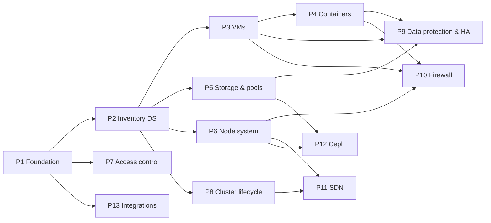

# Roadmap — `terraform-provider-pve`

A phased build plan for a modern Terraform provider (Plugin Framework) for Proxmox Virtual Environment, with the goal that **every declarative aspect of a Proxmox node and cluster is configurable via Terraform**.

- **Source of truth for API surface:** [apidoc.js](https://pve.proxmox.com/pve-docs/api-viewer/apidoc.js) (PVE API schema, 449 endpoints / path families at the time of writing).
- **Coverage guarantee:** every API path family is assigned to exactly one phase or to Out-of-scope with a reason — see **Appendix A**. No orphaned API surface.
- **Current repo state:** Phases 1–13 implemented. The provider surface is **generated** from the API schema: `go run ./gen` parses `internal/pveapidoc/schema/apidoc.js` (449 families) plus the phase mappings in `gen/mapping/`, audits full coverage, and emits `internal/provider/registry.json`, Appendix A, and per-type examples. Generic runtime engines (resource / data source / action / function) interpret the registry — no per-type hand-written provider code. Verification level: `go build`, `go vet`, `golangci-lint`, unit tests (`go test ./...`, including httptest-backed engine tests and the registry/schema smoke tests). Live-lab acceptance (`TF_ACC`) is pending a cluster.

Each phase is designed as one bounded objective with its own attempt cap. Originally intended to ship as separate releases (`v0.<phase>.0`); phases 2–13 were delivered as one consolidated, generated `v0.2.0`. Partial phases are never "good enough" to skip their acceptance list.

---

## Conventions (apply to every phase)

| Topic | Decision |
|---|---|
| Provider name / registry address | `pve` at `registry.terraform.io/dwhoban/pve`, module `github.com/dwhoban/terraform-provider-pve` (resolved in Phase 1; the historical repo-directory typo is fixed) |
| Type naming | resources `pve_<noun>[_<sub>]`, data sources `pve_<noun>`, actions `pve_<noun>_<verb>` (framework actions), functions `<verb>_x` only where no data source fits |
| **Generation process** | Provider types are **not hand-written**: every type is produced by transforming the API schema. `apidoc.js` → `internal/pveapidoc` (typed tree) → `gen/mapping/phase<N>.go` (type name → endpoint mapping; the only manual input, guide in `gen/MAPPING.md`) → `go run ./gen` derives attributes/types/validators/defaults/IDs from parameters and `returns` schemas, audits coverage, and emits `internal/provider/registry.json` + Appendix A + examples. Four generic runtime engines (resource / data source / action / function) interpret the registry. Changing the provider surface = changing the mapping or the schema snapshot, never engine code per type |
| Async operations | Every PVE mutation returns a task UPID. The client polls `/nodes/{node}/tasks/{upid}/status` with configurable timeouts; CRUD blocks until task exit, error message surfaces the task log tail |
| Auth | Explicit config with env fallback: `api_url` (`PVE_API_URL`), `api_token` (`PVE_API_TOKEN`, ephemeral/sensitive), `username`/`password`+`totp` (`PVE_USER`/`PVE_PASSWORD`) via `/access/ticket`, `insecure`/`ca_cert` for TLS. API-token auth is the tested default |
| Error handling | Typed API errors (403, 5xx, task failure) mapped to actionable diagnostics; idempotent re-plan after any apply failure must not produce surprise diffs |
| State discipline | Import (`terraform import`) implemented for every resource; after apply, a no-op `terraform plan` is part of acceptance |
| Docs & examples | Every type gets `docs/{resources,data-sources,actions,functions}/<type>.md` via `tfplugindocs` + a runnable example under `examples/` |
| Tests | Unit tests for client/models; acceptance tests (`TF_ACC=1`) run against a live lab cluster via env: `PVE_API_URL`, `PVE_API_TOKEN`, `PVE_NODE`, `PVE_STORAGE`, `PVE_TEST_ISO` |

**Definition of done (binary, every phase):**

1. `go build ./...` exits 0.
2. `go test ./...` exits 0 (unit).
3. Every type listed in the phase is declared in `gen/mapping/phase<N>.go`; `go run ./gen` emits it into the registry and the provider registers the full registry (`Resources()`, `DataSources()`, `Actions()`, `Functions()`) with zero per-type code.
4. `TF_ACC=1 go test ./internal/provider/... -run 'TestAcc<Phase>' -timeout 120m` exits 0 against the lab cluster, including the phase's acceptance scenarios below and a no-op re-plan for each resource. *(Deferred: this delivery run was scoped to build/lint/vet/unit verification only — run the acceptance suites when a lab cluster is available.)*
5. Docs + example exist for every type; `tfplugindocs` output is committed and current.

**Verification commands (every phase):**

```bash
go build ./... && go test ./...
TF_ACC=1 PVE_API_URL=... PVE_API_TOKEN=... go test ./internal/provider/... -run 'TestAcc<Phase>' -timeout 120m
```

---

## Phase 1 — Foundation: provider scaffold, config, API client, task engine

**Depends on:** nothing. **Turns the scaffold into a provider.** **Status: ✅ complete (`v0.1.0`)**

| Work | Detail |
|---|---|
| Rename scaffold | module `github.com/<org>/terraform-provider-pve`, provider address, `main.go` TODO removal, README |
| Provider schema | `api_url`, `api_token`, `username`, `password`, `totp`, `insecure`, `ca_cert`, `request_timeout` with env fallbacks; configure-time validation (reachability + auth check) |
| API client | REST client (`/api2/json`), typed errors, retry on 5xx/connection errors with backoff, TLS handling |
| Task engine | UPID parse + poll until task exit, timeouts, task log tail in errors |
| Data source | `pve_version` (`/version`) — smoke test for client + auth |

**API surface:** `/version`, `/access/ticket`.
**Acceptance scenarios:** token auth plan succeeds; wrong token → plan fails with clear diagnostic; password auth (ticket) round-trips; `pve_version` returns the lab's version.

## Phase 2 — Inventory & capability data sources (read-only)

**Status: ✅ implemented and live-verified (`v0.2.0`): unit suite plus `TF_ACC` acceptance against the lab (11 data-source scenarios passing; node-agreement and `nextid()`-is-free scenarios passing; 4 scenarios skipped for missing lab fixtures — NFS server, VG, root-only backup-info, test URL).**

**Depends on:** Phase 1. **Delivers immediate value; zero write risk.**

| Type | Kind | API surface |
|---|---|---|
| `pve_cluster` | data source | `/cluster`, `/cluster/status`, `/cluster/resources`, `/cluster/tasks` |
| `pve_node`, `pve_nodes` | data source | `/nodes`, `/nodes/{node}`, `/nodes/{node}/status`, `/nodes/{node}/version` |
| `pve_node_capabilities` | data source | `/nodes/{node}/capabilities/*` (CPU models, flags, machine types, migration caps) |
| `pve_node_hardware` | data source | `/nodes/{node}/hardware/pci*`, `usb`, `mdev` (passthrough discovery) |
| `pve_node_disks` | data source | `/nodes/{node}/disks`, `disks/list`, `disks/smart` |
| `pve_node_storages` | data source | `/nodes/{node}/storage`, `/nodes/{node}/storage/{storeid}` (+ `/status`) |
| `pve_storage_scan_*` (`nfs`, `cifs`, `iscsi`, `lvm`, `lvmthin`, `zfs`, `pbs`) | data sources | `/nodes/{node}/scan/*` — authoring aid for storage resources |
| `pve_appliance_templates` | data source | `/nodes/{node}/aplinfo` |
| `pve_task` | data source | `/nodes/{node}/tasks/{upid}`, `/cluster/tasks` |
| `pve_backup_info` | data source | `/cluster/backup-info`, `/cluster/backup-info/not-backed-up` |
| `pve_url_metadata`, `pve_oci_repo_tags` | data sources | `/nodes/{node}/query-url-metadata`, `query-oci-repo-tags` |
| `nextid()` | provider function | `/cluster/nextid` |

**Acceptance scenarios:** every data source has a `TF_ACC` test reading the live lab (values asserted non-empty and shape-checked); `pve_node` and `pve_nodes` agree on node list; `nextid()` returns an unused VMID (verified against `pve_cluster` resources); at least one `pve_storage_scan_*` (nfs) returns parseable results.

## Phase 3 — Virtual machines (QEMU)

**Status: ✅ implemented and live-verified (`v0.2.0`): VM lifecycle (create/config-update/import), create-from-ISO with the start action (Alpine ISO fetched onto the lab via download-url), snapshot create + rollback action, and full clone-at-create — all against the lab with no leftover guests. vmid is Required (PVE mandates it; pair with `provider::pve::nextid()`).**

**Depends on:** Phase 2 (capabilities, nextid, storage content, task engine).

| Type | Kind | API surface |
|---|---|---|
| `pve_vm` | resource | `/nodes/{node}/qemu` (create), `/qemu/{vmid}/config` (read/update), delete; disks, NICs, cloud-init (`/cloudinit`, `/cloudinit/dump`), `resize`, `move_disk`, `unlink`, `pending`, `feature`; clone-at-create (`/clone`) and `template` (`/template`) |
| `pve_vm` (read) | data source | config + `/status/current` + agent facts (`/agent/info`, `ping`, `get-osinfo`, `network-get-interfaces`, …) |
| `pve_vm_snapshot` | resource | `/snapshot`, `/snapshot/{name}`, `/{name}/config`, `/{name}/rollback` (rollback = action) |
| actions `pve_vm_start/stop/reboot/reset/shutdown/suspend/resume/migrate` | actions | `/status/*`, `/migrate` |
| `pve_guest_bulk_{start,shutdown,migrate,suspend}` | actions | `/cluster/bulk-action/guest/*` |
| `pve_custom_cpu_model` | resource | `/cluster/qemu/custom-cpu-models` (+ `cpu-flags` read) |

**Acceptance scenarios:** full lifecycle — create from ISO and from clone/template; hot updates (CPU/memory, disk resize, NIC change); snapshot create + rollback; all actions; `terraform import pve_vm.x <node>/<vmid>` → no-op plan.
**Note:** interactive sub-endpoints (console, `agent/exec`, `agent/file-*`, `set-user-password`) are never exposed — see Out-of-scope.

## Phase 4 — LXC containers

**Status: ✅ implemented and live-verified (`v0.2.0`): container lifecycle (create from an Alpine vztmpl fetched onto the lab, config update, import), start/stop actions via `action_trigger` with status verified through the API, and snapshot lifecycle. rootfs stays unset in config by convention (PVE normalizes it to a concrete volume path that cannot be pre-stated); `storage` selects placement.**

**Depends on:** Phase 3 (shared guest framework).

| Type | Kind | API surface |
|---|---|---|
| `pve_container` | resource | `/nodes/{node}/lxc`, `/lxc/{vmid}/config`, delete; `resize`, `move_volume`, `template`, `clone`, `pending`, `feature` |
| `pve_container` (read) | data source | config + `/status/current` + `/interfaces` (guest IPs) |
| `pve_container_snapshot` | resource | `/snapshot*`, rollback action |
| actions `pve_container_start/stop/reboot/shutdown/suspend/resume/migrate` | actions | `/status/*`, `/migrate`, `remote_migrate` |

**Acceptance scenarios:** create from template + resize rootfs + config update; snapshot lifecycle; actions; import → no-op plan.

## Phase 5 — Storage & pools

**Status: ✅ implemented and live-verified (`v0.2.0`): pool lifecycle (create/update/import/destroy), dir-storage CRUD round-trip with set-typed content lists, and the file download-url action end-to-end (`action_trigger` → node fetch → content listing → cleanup) against the lab. Multipart upload remains a documented engine gap; the NFS-storage scenario needs an NFS server (skip-gated).**

**Depends on:** Phase 2. (Guest disks/volumes in Phases 3–4 reference these.)

| Type | Kind | API surface |
|---|---|---|
| `pve_storage` | resource | `/storage`, `/storage/{storeid}` (all backends: dir, nfs, cifs, zfs, lvm, ceph*, pbs,…) |
| `pve_storage` (read) | data source | `/storage` list + content overview |
| `pve_pool` | resource | `/pools`, `/pools/{poolid}` (members as computed set) |
| `pve_file` | resource | `/nodes/{node}/storage/{store}/content` CRUD, `upload`, `download-url`, `oci-registry-pull` |
| actions `pve_storage_prune_backups` | action | `/prunebackups` |
| `pve_storage_identity`, `pve_storage_import_metadata`, `pve_file_restore_list` | data sources | `/identity`, `/import-metadata`, `/file-restore/list` |
| action `pve_file_restore_download` | action | `/file-restore/download` |

**Acceptance scenarios:** NFS storage CRUD round-trip; pool membership changes; file download-url + upload + delete; import each resource → no-op plan.

## Phase 6 — Node system management

**Status: ✅ implemented and live-verified within a safe scope (`v0.2.0`): the staged-apply network lifecycle on a dummy bridge (create stages, update applies, import; staged deletion flushed and verified gone), same-value singleton round-trips for DNS and time, and the service/APT data sources. Deliberately not exercised against the lab: disk management (no scratch disk), subscription writes, and node power actions (would bounce the node).**

**Depends on:** Phase 2. **Contains staged-apply and destructive operations — flag them.**

| Type | Kind | API surface |
|---|---|---|
| `pve_node_network` | resource | `/nodes/{node}/network` CRUD (`/{iface}`) + **apply** (`PUT /network`) — models PVE's staging semantics: Create/Delete stage, Update applies; drift read via `GET /network` |
| `pve_node_dns`, `pve_node_time`, `pve_node_hosts`, `pve_node_config` | singleton resources | `/dns`, `/time`, `/hosts`, `/config` |
| `pve_node_disk_{lvm,lvmthin,zfs,directory}` | resources | `/disks/{kind}` CRUD |
| actions `pve_node_disk_initgpt`, `pve_node_disk_wipe` | actions (destructive) | `/disks/initgpt`, `/disks/wipedisk` |
| `pve_subscription` | resource | `/subscription` GET/POST/PUT/DELETE |
| `pve_node_services` | data source + actions `pve_service_{start,stop,restart,reload}` | `/services*` |
| `pve_apt_repositories` | data source | `GET /apt/repositories` (+ `GET /apt`, `/apt/versions` data sources); toggled by the hand-written resource `pve_apt_standard_repository` |
| action `pve_apt_update` | action | `/apt/update` |
| actions `pve_node_reboot/shutdown`, `pve_node_{startall,stopall,suspendall,wakeonlan,migrate_all}` | actions | `POST /status`, `/startall`, `/stopall`, `/suspendall`, `/wakeonlan`, `/migrateall` |

**Acceptance scenarios:** VLAN bridge create → applied → survives reboot (apply vs revert path); DNS/time/hosts round-trip; ZFS pool create/destroy on scratch disk; service restart action; destructive actions require explicit opt-in attribute and log target disk/node.

## Phase 7 — Access control (RBAC)

**Status: ✅ implemented (`v0.2.0`) — unit-verified; live `TF_ACC` acceptance pending lab.**

**Depends on:** Phase 1. **Parallelizable with Phase 2.**

| Type | Kind | API surface |
|---|---|---|
| `pve_user`, `pve_group`, `pve_role` | resources | `/access/users*`, `/access/groups*`, `/access/roles*` |
| `pve_api_token` | resource | `/access/users/{user}/token*` (token value written once, sensitive) |
| `pve_acl` | resource | `/access/acl` (PUT/GET; delete = remove entry) |
| `pve_realm` | resource | `/access/domains*` + action `pve_realm_sync` (`/sync`) |
| `pve_permissions` | data source | `/access/permissions` |

**Acceptance scenarios:** user+token lifecycle (token usable for a child provider instance); role + ACL grant/revoke; realm CRUD with sync dry-run.

## Phase 8 — Cluster lifecycle & configuration

**Status: ✅ implemented (`v0.2.0`) — unit-verified; live `TF_ACC` acceptance pending lab.**

**Depends on:** Phase 2. **Create/join/remove are cluster-altering; acceptance uses a dedicated 2-node lab.**

| Type | Kind | API surface |
|---|---|---|
| `pve_cluster_options` | resource | `/cluster/options` (GET/PUT) |
| `pve_cluster` | resource (create-only lifecycle) | `POST /cluster/config` (create on seed node), `GET /cluster/config` (read); no API delete exists — destroy removes from state only. Pairs with the Phase 2 `pve_cluster` inventory data source |
| `pve_cluster_join_info` / action `pve_cluster_join` | data source / action | `/cluster/config/join` (GET join info; POST join) |
| action `pve_cluster_node_remove` | action (risky) | `/cluster/config/nodes/{node}` DELETE |
| `pve_mapping_{dir,pci,usb}` | resources | `/cluster/mapping/*` |
| `pve_cluster_api_version`, `pve_cluster_qdevice`, `pve_cluster_totem` | data sources | `/cluster/config/apiversion`, `/qdevice`, `/totem` |

**Acceptance scenarios:** options round-trip; mapping CRUD; lab cluster create → join → remove full flow.

## Phase 9 — Data protection & availability

**Status: ✅ implemented (`v0.2.0`) — unit-verified; live `TF_ACC` acceptance pending lab.**

**Depends on:** Phases 3, 4, 5 (protected objects + backup targets).

| Type | Kind | API surface |
|---|---|---|
| `pve_backup_job` | resource | `/cluster/backup*` |
| `pve_replication_job` | resource | `/cluster/replication*` (+ `/nodes/{node}/replication*` reads, `schedule_now` action) |
| `pve_ha_{group,resource,rule}` | resources | `/cluster/ha/{groups,resources,rules}*`; actions `migrate`, `relocate` |
| `pve_realm_sync_job` | resource | `/cluster/jobs/realm-sync*` |
| `pve_ha_status`, `pve_vzdump_defaults`, `pve_vzdump_extractconfig` | data sources | `/cluster/ha/status*`, `/nodes/{node}/vzdump/defaults`, `/extractconfig` |
| actions `pve_backup_run` (vzdump), `pve_ha_{arm,disarm}` | actions | `POST /nodes/{node}/vzdump`, `/cluster/ha/status/{arm,disarm}-ha` |
| `schedule_analyze()` | provider function | `/cluster/jobs/schedule-analyze` |

**Acceptance scenarios:** backup job CRUD + `schedule_analyze` validates cron; replication job CRUD + `schedule_now` on lab pair; HA group/resource CRUD with fenced start.

## Phase 10 — Firewall (cluster, node, guest scopes)

**Status: ✅ implemented (`v0.2.0`) — unit-verified; live `TF_ACC` acceptance pending lab.**

**Depends on:** Phases 3, 4, 6 (attachment points exist). One shared schema across scopes.

| Type | Kind | API surface |
|---|---|---|
| `pve_firewall_rule` | resource (scope: `cluster` \| `node` \| `vm` \| `container`) | `/{cluster\|node\|qemu\|lxc}/…/firewall/rules*` |
| `pve_firewall_ipset` (+ entries), `pve_firewall_alias`, `pve_firewall_group` (+ member rules) | resources | `…/firewall/{ipset,aliases,groups}*` |
| `pve_firewall_options` | singleton resource per scope | `…/firewall/options` |
| `pve_firewall_macros`, `pve_firewall_refs` | data sources | `/cluster/firewall/{macros,refs}` |

**Acceptance scenarios:** rule CRUD at all four scopes (incl. security-group style groups); options enable/disable; ipset entry add/remove; import → no-op plan.

## Phase 11 — SDN (software-defined networking)

**Status: ✅ implemented and live-verified within a safe scope (`v0.2.0`): VLAN zone on the isolated bridge `vmbr1` + vnet + subnet CRUD with in-place updates and import, `dry_run` data source, the `pve_sdn_apply` action via `action_trigger`, runtime status data source, and teardown verified (config empty after destroy). Not exercised: guest NIC/DHCP attach (dnsmasq not installed), controllers/fabrics/IPAM/DNS backends, rollback path.**

**Depends on:** Phases 6, 8 (node network + cluster apply).

| Type | Kind | API surface |
|---|---|---|
| `pve_sdn_{zone,vnet,subnet}` | resources | `/cluster/sdn/{zones,vnets}`, `/vnets/{vnet}/subnets*`; IP mgmt via `/vnets/{vnet}/ips` |
| `pve_sdn_controller`, `pve_sdn_dns`, `pve_sdn_ipam` | resources | `/cluster/sdn/{controllers,dns,ipams}*` (+ `ipams/{id}/status` read) |
| `pve_sdn_prefix_list` (+ entries), `pve_sdn_route_map` (+ entries) | resources | `/cluster/sdn/{prefix-lists,route-maps}*` |
| `pve_sdn_fabric` (+ node config) | resources | `/cluster/sdn/fabrics*`, `/fabrics/node*` |
| actions `pve_sdn_apply`, `pve_sdn_rollback`, `pve_sdn_lock_release`; `pve_sdn_dry_run` data source | actions / data source | `PUT /cluster/sdn`, `/rollback`, `/lock`, `/dry-run` |
| `pve_sdn_status` | data source | `/nodes/{node}/sdn*` (runtime zones/vnets/bridges/fabric state) |

**Acceptance scenarios:** zone+vnet+subnet CRUD → `dry_run` clean → `apply` → guest NIC attaches to vnet with DHCP IP; rollback path on bad config.

## Phase 12 — Ceph

**Status: ✅ implemented (`v0.2.0`) — unit-verified; live `TF_ACC` acceptance pending lab.**

**Depends on:** Phases 5, 6 (storage + disks). **Destructive; lab with scratch disks only.** Ceph packages must be present on the node: the API cannot install them, so the hand-written `pve_ceph_install` action runs `pveceph install` over the provider's optional `ssh` block (see the "When is SSH required?" guide).

| Type | Kind | API surface |
|---|---|---|
| `pve_ceph_osd`, `pve_ceph_pool` | resources | `/nodes/{node}/ceph/{osd,pool}*` (create on disk, destroy w/ explicit flag) |
| `pve_ceph_{mon,mgr,mds,fs}` | resources | `/ceph/{mon,mgr,mds,fs}*` |
| `pve_ceph_flags` | resource | `/cluster/ceph/flags*` |
| actions `pve_ceph_init`, `pve_ceph_{start,stop,restart}`, `pve_ceph_osd_{in,out,scrub}`, `pve_ceph_health_mute` | actions | `/ceph/init`, `/ceph/{start,stop,restart}`, osd `in/out/scrub`, `/cluster/ceph/health-mute*` |
| `pve_ceph_status` etc. | data sources | `/ceph/{status,crush,rules,releases,metadata}`, cfg reads |

**Acceptance scenarios:** init → mon → osd on scratch disk → pool → `pve_storage` (rbd) consumes it; OSD out+destroy with explicit flag; flags round-trip.

## Phase 13 — Integrations: notifications, metrics, ACME, certificates

**Status: ✅ implemented (`v0.2.0`) — unit-verified; live `TF_ACC` acceptance pending lab.**

**Depends on:** Phase 1. **Parallelizable anytime after Phase 2.**

| Type | Kind | API surface |
|---|---|---|
| `pve_notification_endpoint_{gotify,sendmail,smtp,webhook}` | resources | `/cluster/notifications/endpoints/*` (+ `targets/{id}/test` action) |
| `pve_notification_matcher` | resource | `/cluster/notifications/matchers*` (+ matcher-fields data sources) |
| `pve_metric_server` | resource | `/cluster/metrics/server*` |
| `pve_acme_account`, `pve_acme_plugin` | resources | `/cluster/acme/{account,plugins}*` |
| `pve_node_certificate` | resource (acme order or custom upload) | `/nodes/{node}/certificates/{acme,custom}*` |
| `pve_acme_directories`, `pve_certificate_info` | data sources | `/cluster/acme/{directories,tos,challenge-schema}`, `/certificates/info` |

**Acceptance scenarios:** endpoint CRUD + `test` send; matcher CRUD; metric server CRUD; ACME against staging CA on lab node with DNS plugin.

---

## Out of scope (61 families, with reasons)

| Category | Families | Reason |
|---|---|---|
| Console & interactive session tunnels | `*termproxy`, `*vncproxy`, `*vncwebsocket`, `*vncshell`, `*spiceproxy`, `*spiceshell`, `*mtunnel*`, `sendkey`, `monitor`, `dbus-vmstate` | Human-interactive surfaces; not declarative config. Revisit only as read-only diagnostics data sources if ever needed |
| QEMU guest-agent imperative ops | `agent/exec*`, `agent/file-*`, `agent/set-user-password`, `agent/shutdown`, `agent/suspend-*`, `agent/fsfreeze-*` | Arbitrary imperative mutation inside guests defeats plan/apply semantics; read-only agent facts (osinfo, interfaces, ping) are exposed via the `pve_vm` data source in Phase 3 |
| Metrics & time-series | `*rrd`, `*rrddata`, `/cluster/metrics`, `/cluster/metrics/export` | Belongs to a monitoring stack (Prometheus et al.), not Terraform state |
| Log streaming | `*syslog`, `*journal`, `/cluster/log`, `*/log` (task & firewall logs) | Streaming reads, not config. Task *status* (not log) is in Phase 2 |
| Arbitrary execution | `/nodes/{node}/execute`, `/nodes/{node}/report` | Command execution on nodes is unsafe and non-declarative; `report` is a diagnostic bundle |
| Session & self-service identity | `/access/{openid,password,tfa,vncticket}` (auth flows) | Interactive/session surfaces; provider auth uses `/access/ticket` + API tokens (Phase 1). TFA *policy* config for users arrives with `/access/users` in Phase 7 where declarative |
| Node traffic diagnostics | `/nodes/{node}/netstat` | Diagnostics; superseded by monitoring stack |

---

## Dependency graph



Recommended order: 1 → 2 → 3 → … → 13 (P7 and P13 can slot in whenever a break from guest work is wanted; P11/P12 last as they need the most lab setup).

## Keeping this roadmap honest (coverage audit)

Appendix A is generated from the API schema snapshot. Re-audit after any schema change — the whole process is automated (`go run ./gen` / `make gen`, mapping guide in `gen/MAPPING.md`):

1. Update `internal/pveapidoc/schema/apidoc.js` from [apidoc.js](https://pve.proxmox.com/pve-docs/api-viewer/apidoc.js).
2. `go run ./gen extract-phases` re-extracts Appendix A assignments; `go run ./gen` then parses the schema, derives every type from `gen/mapping/phase*.go`, and **exits non-zero** on any new, missing, moved, or out-of-scope-referenced family — new endpoints must be consciously triaged into a phase mapping or Out-of-scope.
3. On success it re-emits `internal/provider/registry.json` (the provider's entire type surface), Appendix A, and the `examples/` tree.

Unit tests pin the invariants continuously: `internal/pveapidoc` (449 families), `gen` (derive + structure audit + 388/61 phase/OOS assignments), and `internal/provider` (every registry type constructs and serves a valid schema; engine behavior is exercised against an httptest PVE stub).

---

## Appendix A — Full API surface mapping (449 families)

| API path (`{*}` = placeholder) | Methods | Phase |
|---|---|---|
| `/access` | GET | 7 — Access control |
| `/access/acl` | GET, PUT | 7 — Access control |
| `/access/domains` | GET, POST | 7 — Access control |
| `/access/domains/{*}` | GET, PUT, DELETE | 7 — Access control |
| `/access/domains/{*}/sync` | POST | 7 — Access control |
| `/access/groups` | GET, POST | 7 — Access control |
| `/access/groups/{*}` | GET, PUT, DELETE | 7 — Access control |
| `/access/openid` | GET | OOS |
| `/access/openid/auth-url` | POST | OOS |
| `/access/openid/login` | POST | OOS |
| `/access/password` | PUT | OOS |
| `/access/permissions` | GET | 7 — Access control |
| `/access/roles` | GET, POST | 7 — Access control |
| `/access/roles/{*}` | GET, PUT, DELETE | 7 — Access control |
| `/access/tfa` | GET | OOS |
| `/access/tfa/{*}` | GET, POST | OOS |
| `/access/tfa/{*}/{*}` | GET, PUT, DELETE | OOS |
| `/access/ticket` | GET, POST | 1 — Foundation |
| `/access/users` | GET, POST | 7 — Access control |
| `/access/users/{*}` | GET, PUT, DELETE | 7 — Access control |
| `/access/users/{*}/tfa` | GET | 7 — Access control |
| `/access/users/{*}/token` | GET | 7 — Access control |
| `/access/users/{*}/token/{*}` | GET, POST, PUT, DELETE | 7 — Access control |
| `/access/users/{*}/unlock-tfa` | PUT | 7 — Access control |
| `/access/vncticket` | POST | OOS |
| `/cluster` | GET | 2 — Inventory data sources |
| `/cluster/acme` | GET | 13 — Integrations |
| `/cluster/acme/account` | GET, POST | 13 — Integrations |
| `/cluster/acme/account/{*}` | GET, PUT, DELETE | 13 — Integrations |
| `/cluster/acme/challenge-schema` | GET | 13 — Integrations |
| `/cluster/acme/directories` | GET | 13 — Integrations |
| `/cluster/acme/meta` | GET | 13 — Integrations |
| `/cluster/acme/plugins` | GET, POST | 13 — Integrations |
| `/cluster/acme/plugins/{*}` | GET, PUT, DELETE | 13 — Integrations |
| `/cluster/acme/tos` | GET | 13 — Integrations |
| `/cluster/backup` | GET, POST | 9 — Data protection & HA |
| `/cluster/backup-info` | GET | 9 — Data protection & HA |
| `/cluster/backup-info/not-backed-up` | GET | 9 — Data protection & HA |
| `/cluster/backup/{*}` | GET, PUT, DELETE | 9 — Data protection & HA |
| `/cluster/backup/{*}/included_volumes` | GET | 9 — Data protection & HA |
| `/cluster/bulk-action` | GET | 3 — Virtual machines |
| `/cluster/bulk-action/guest` | GET | 3 — Virtual machines |
| `/cluster/bulk-action/guest/migrate` | POST | 3 — Virtual machines |
| `/cluster/bulk-action/guest/shutdown` | POST | 3 — Virtual machines |
| `/cluster/bulk-action/guest/start` | POST | 3 — Virtual machines |
| `/cluster/bulk-action/guest/suspend` | POST | 3 — Virtual machines |
| `/cluster/ceph` | GET | 12 — Ceph |
| `/cluster/ceph/flags` | GET, PUT | 12 — Ceph |
| `/cluster/ceph/flags/{*}` | GET, PUT | 12 — Ceph |
| `/cluster/ceph/health-mute` | GET | 12 — Ceph |
| `/cluster/ceph/health-mute/{*}` | PUT | 12 — Ceph |
| `/cluster/ceph/metadata` | GET | 12 — Ceph |
| `/cluster/ceph/restart-bulk` | POST | 12 — Ceph |
| `/cluster/ceph/status` | GET | 12 — Ceph |
| `/cluster/config` | GET, POST | 8 — Cluster lifecycle |
| `/cluster/config/apiversion` | GET | 8 — Cluster lifecycle |
| `/cluster/config/join` | GET, POST | 8 — Cluster lifecycle |
| `/cluster/config/nodes` | GET | 8 — Cluster lifecycle |
| `/cluster/config/nodes/{*}` | POST, DELETE | 8 — Cluster lifecycle |
| `/cluster/config/qdevice` | GET | 8 — Cluster lifecycle |
| `/cluster/config/totem` | GET | 8 — Cluster lifecycle |
| `/cluster/firewall` | GET | 10 — Firewall |
| `/cluster/firewall/aliases` | GET, POST | 10 — Firewall |
| `/cluster/firewall/aliases/{*}` | GET, PUT, DELETE | 10 — Firewall |
| `/cluster/firewall/groups` | GET, POST | 10 — Firewall |
| `/cluster/firewall/groups/{*}` | GET, POST, DELETE | 10 — Firewall |
| `/cluster/firewall/groups/{*}/{*}` | GET, PUT, DELETE | 10 — Firewall |
| `/cluster/firewall/ipset` | GET, POST | 10 — Firewall |
| `/cluster/firewall/ipset/{*}` | GET, POST, DELETE | 10 — Firewall |
| `/cluster/firewall/ipset/{*}/{*}` | GET, PUT, DELETE | 10 — Firewall |
| `/cluster/firewall/macros` | GET | 10 — Firewall |
| `/cluster/firewall/options` | GET, PUT | 10 — Firewall |
| `/cluster/firewall/refs` | GET | 10 — Firewall |
| `/cluster/firewall/rules` | GET, POST | 10 — Firewall |
| `/cluster/firewall/rules/{*}` | GET, PUT, DELETE | 10 — Firewall |
| `/cluster/ha` | GET | 9 — Data protection & HA |
| `/cluster/ha/groups` | GET, POST | 9 — Data protection & HA |
| `/cluster/ha/groups/{*}` | GET, PUT, DELETE | 9 — Data protection & HA |
| `/cluster/ha/resources` | GET, POST | 9 — Data protection & HA |
| `/cluster/ha/resources/{*}` | GET, PUT, DELETE | 9 — Data protection & HA |
| `/cluster/ha/resources/{*}/migrate` | POST | 9 — Data protection & HA |
| `/cluster/ha/resources/{*}/relocate` | POST | 9 — Data protection & HA |
| `/cluster/ha/rules` | GET, POST | 9 — Data protection & HA |
| `/cluster/ha/rules/{*}` | GET, PUT, DELETE | 9 — Data protection & HA |
| `/cluster/ha/status` | GET | 9 — Data protection & HA |
| `/cluster/ha/status/arm-ha` | POST | 9 — Data protection & HA |
| `/cluster/ha/status/current` | GET | 9 — Data protection & HA |
| `/cluster/ha/status/disarm-ha` | POST | 9 — Data protection & HA |
| `/cluster/ha/status/manager_status` | GET | 9 — Data protection & HA |
| `/cluster/jobs` | GET | 9 — Data protection & HA |
| `/cluster/jobs/realm-sync` | GET | 9 — Data protection & HA |
| `/cluster/jobs/realm-sync/{*}` | GET, POST, PUT, DELETE | 9 — Data protection & HA |
| `/cluster/jobs/schedule-analyze` | GET | 9 — Data protection & HA |
| `/cluster/log` | GET | OOS |
| `/cluster/mapping` | GET | 8 — Cluster lifecycle |
| `/cluster/mapping/dir` | GET, POST | 8 — Cluster lifecycle |
| `/cluster/mapping/dir/{*}` | GET, PUT, DELETE | 8 — Cluster lifecycle |
| `/cluster/mapping/pci` | GET, POST | 8 — Cluster lifecycle |
| `/cluster/mapping/pci/{*}` | GET, PUT, DELETE | 8 — Cluster lifecycle |
| `/cluster/mapping/usb` | GET, POST | 8 — Cluster lifecycle |
| `/cluster/mapping/usb/{*}` | GET, PUT, DELETE | 8 — Cluster lifecycle |
| `/cluster/metrics` | GET | OOS |
| `/cluster/metrics/export` | GET | OOS |
| `/cluster/metrics/server` | GET | 13 — Integrations |
| `/cluster/metrics/server/{*}` | GET, POST, PUT, DELETE | 13 — Integrations |
| `/cluster/nextid` | GET | 2 — Inventory data sources |
| `/cluster/notifications` | GET | 13 — Integrations |
| `/cluster/notifications/endpoints` | GET | 13 — Integrations |
| `/cluster/notifications/endpoints/gotify` | GET, POST | 13 — Integrations |
| `/cluster/notifications/endpoints/gotify/{*}` | GET, PUT, DELETE | 13 — Integrations |
| `/cluster/notifications/endpoints/sendmail` | GET, POST | 13 — Integrations |
| `/cluster/notifications/endpoints/sendmail/{*}` | GET, PUT, DELETE | 13 — Integrations |
| `/cluster/notifications/endpoints/smtp` | GET, POST | 13 — Integrations |
| `/cluster/notifications/endpoints/smtp/{*}` | GET, PUT, DELETE | 13 — Integrations |
| `/cluster/notifications/endpoints/webhook` | GET, POST | 13 — Integrations |
| `/cluster/notifications/endpoints/webhook/{*}` | GET, PUT, DELETE | 13 — Integrations |
| `/cluster/notifications/matcher-field-values` | GET | 13 — Integrations |
| `/cluster/notifications/matcher-fields` | GET | 13 — Integrations |
| `/cluster/notifications/matchers` | GET, POST | 13 — Integrations |
| `/cluster/notifications/matchers/{*}` | GET, PUT, DELETE | 13 — Integrations |
| `/cluster/notifications/targets` | GET | 13 — Integrations |
| `/cluster/notifications/targets/{*}/test` | POST | 13 — Integrations |
| `/cluster/options` | GET, PUT | 8 — Cluster lifecycle |
| `/cluster/qemu` | GET | 3 — Virtual machines |
| `/cluster/qemu/cpu-flags` | GET | 3 — Virtual machines |
| `/cluster/qemu/custom-cpu-models` | GET, POST | 3 — Virtual machines |
| `/cluster/qemu/custom-cpu-models/{*}` | GET, PUT, DELETE | 3 — Virtual machines |
| `/cluster/replication` | GET, POST | 9 — Data protection & HA |
| `/cluster/replication/{*}` | GET, PUT, DELETE | 9 — Data protection & HA |
| `/cluster/resources` | GET | 2 — Inventory data sources |
| `/cluster/sdn` | GET, PUT | 11 — SDN |
| `/cluster/sdn/controllers` | GET, POST | 11 — SDN |
| `/cluster/sdn/controllers/{*}` | GET, PUT, DELETE | 11 — SDN |
| `/cluster/sdn/dns` | GET, POST | 11 — SDN |
| `/cluster/sdn/dns/{*}` | GET, PUT, DELETE | 11 — SDN |
| `/cluster/sdn/dry-run` | GET | 11 — SDN |
| `/cluster/sdn/fabrics` | GET | 11 — SDN |
| `/cluster/sdn/fabrics/all` | GET | 11 — SDN |
| `/cluster/sdn/fabrics/fabric` | GET, POST | 11 — SDN |
| `/cluster/sdn/fabrics/fabric/{*}` | GET, PUT, DELETE | 11 — SDN |
| `/cluster/sdn/fabrics/node` | GET | 11 — SDN |
| `/cluster/sdn/fabrics/node/{*}` | GET, POST | 11 — SDN |
| `/cluster/sdn/fabrics/node/{*}/{*}` | GET, PUT, DELETE | 11 — SDN |
| `/cluster/sdn/ipams` | GET, POST | 11 — SDN |
| `/cluster/sdn/ipams/{*}` | GET, PUT, DELETE | 11 — SDN |
| `/cluster/sdn/ipams/{*}/status` | GET | 11 — SDN |
| `/cluster/sdn/lock` | POST, DELETE | 11 — SDN |
| `/cluster/sdn/prefix-lists` | GET, POST | 11 — SDN |
| `/cluster/sdn/prefix-lists/{*}` | GET, PUT, DELETE | 11 — SDN |
| `/cluster/sdn/prefix-lists/{*}/entries` | GET, POST | 11 — SDN |
| `/cluster/sdn/prefix-lists/{*}/entries/{*}` | GET, PUT, DELETE | 11 — SDN |
| `/cluster/sdn/rollback` | POST | 11 — SDN |
| `/cluster/sdn/route-maps` | GET | 11 — SDN |
| `/cluster/sdn/route-maps/entries` | GET, POST | 11 — SDN |
| `/cluster/sdn/route-maps/entries/{*}` | GET | 11 — SDN |
| `/cluster/sdn/route-maps/entries/{*}/entry/{*}` | GET, PUT, DELETE | 11 — SDN |
| `/cluster/sdn/vnets` | GET, POST | 11 — SDN |
| `/cluster/sdn/vnets/{*}` | GET, PUT, DELETE | 11 — SDN |
| `/cluster/sdn/vnets/{*}/firewall` | GET | 11 — SDN |
| `/cluster/sdn/vnets/{*}/firewall/options` | GET, PUT | 11 — SDN |
| `/cluster/sdn/vnets/{*}/firewall/rules` | GET, POST | 11 — SDN |
| `/cluster/sdn/vnets/{*}/firewall/rules/{*}` | GET, PUT, DELETE | 11 — SDN |
| `/cluster/sdn/vnets/{*}/ips` | POST, PUT, DELETE | 11 — SDN |
| `/cluster/sdn/vnets/{*}/subnets` | GET, POST | 11 — SDN |
| `/cluster/sdn/vnets/{*}/subnets/{*}` | GET, PUT, DELETE | 11 — SDN |
| `/cluster/sdn/zones` | GET, POST | 11 — SDN |
| `/cluster/sdn/zones/{*}` | GET, PUT, DELETE | 11 — SDN |
| `/cluster/status` | GET | 2 — Inventory data sources |
| `/cluster/tasks` | GET | 2 — Inventory data sources |
| `/nodes` | GET | 2 — Inventory data sources |
| `/nodes/{*}` | GET | 2 — Inventory data sources |
| `/nodes/{*}/aplinfo` | GET, POST | 2 — Inventory data sources |
| `/nodes/{*}/apt` | GET | 6 — Node system management |
| `/nodes/{*}/apt/changelog` | GET | 6 — Node system management |
| `/nodes/{*}/apt/repositories` | GET, POST, PUT | 6 — Node system management |
| `/nodes/{*}/apt/update` | GET, POST | 6 — Node system management |
| `/nodes/{*}/apt/versions` | GET | 6 — Node system management |
| `/nodes/{*}/capabilities` | GET | 2 — Inventory data sources |
| `/nodes/{*}/capabilities/qemu` | GET | 2 — Inventory data sources |
| `/nodes/{*}/capabilities/qemu/cpu` | GET | 2 — Inventory data sources |
| `/nodes/{*}/capabilities/qemu/cpu-flags` | GET | 2 — Inventory data sources |
| `/nodes/{*}/capabilities/qemu/machines` | GET | 2 — Inventory data sources |
| `/nodes/{*}/capabilities/qemu/migration` | GET | 2 — Inventory data sources |
| `/nodes/{*}/ceph` | GET | 12 — Ceph |
| `/nodes/{*}/ceph/cfg` | GET | 12 — Ceph |
| `/nodes/{*}/ceph/cfg/db` | GET | 12 — Ceph |
| `/nodes/{*}/ceph/cfg/raw` | GET | 12 — Ceph |
| `/nodes/{*}/ceph/cfg/value` | GET | 12 — Ceph |
| `/nodes/{*}/ceph/cmd-safety` | GET | 12 — Ceph |
| `/nodes/{*}/ceph/crush` | GET | 12 — Ceph |
| `/nodes/{*}/ceph/fs` | GET | 12 — Ceph |
| `/nodes/{*}/ceph/fs/{*}` | POST, DELETE | 12 — Ceph |
| `/nodes/{*}/ceph/init` | POST | 12 — Ceph |
| `/nodes/{*}/ceph/log` | GET | OOS |
| `/nodes/{*}/ceph/mds` | GET | 12 — Ceph |
| `/nodes/{*}/ceph/mds/{*}` | POST, DELETE | 12 — Ceph |
| `/nodes/{*}/ceph/mgr` | GET | 12 — Ceph |
| `/nodes/{*}/ceph/mgr/{*}` | POST, DELETE | 12 — Ceph |
| `/nodes/{*}/ceph/mon` | GET | 12 — Ceph |
| `/nodes/{*}/ceph/mon/{*}` | POST, DELETE | 12 — Ceph |
| `/nodes/{*}/ceph/osd` | GET, POST | 12 — Ceph |
| `/nodes/{*}/ceph/osd/{*}` | GET, DELETE | 12 — Ceph |
| `/nodes/{*}/ceph/osd/{*}/in` | POST | 12 — Ceph |
| `/nodes/{*}/ceph/osd/{*}/lv-info` | GET | 12 — Ceph |
| `/nodes/{*}/ceph/osd/{*}/metadata` | GET | 12 — Ceph |
| `/nodes/{*}/ceph/osd/{*}/out` | POST | 12 — Ceph |
| `/nodes/{*}/ceph/osd/{*}/scrub` | POST | 12 — Ceph |
| `/nodes/{*}/ceph/pool` | GET, POST | 12 — Ceph |
| `/nodes/{*}/ceph/pool/{*}` | GET, PUT, DELETE | 12 — Ceph |
| `/nodes/{*}/ceph/pool/{*}/status` | GET | 12 — Ceph |
| `/nodes/{*}/ceph/releases` | GET | 12 — Ceph |
| `/nodes/{*}/ceph/restart` | POST | 12 — Ceph |
| `/nodes/{*}/ceph/restart-bulk` | POST | 12 — Ceph |
| `/nodes/{*}/ceph/rules` | GET | 12 — Ceph |
| `/nodes/{*}/ceph/start` | POST | 12 — Ceph |
| `/nodes/{*}/ceph/status` | GET | 12 — Ceph |
| `/nodes/{*}/ceph/stop` | POST | 12 — Ceph |
| `/nodes/{*}/certificates` | GET | 13 — Integrations |
| `/nodes/{*}/certificates/acme` | GET | 13 — Integrations |
| `/nodes/{*}/certificates/acme/certificate` | POST, PUT, DELETE | 13 — Integrations |
| `/nodes/{*}/certificates/custom` | POST, DELETE | 13 — Integrations |
| `/nodes/{*}/certificates/info` | GET | 13 — Integrations |
| `/nodes/{*}/config` | GET, PUT | 6 — Node system management |
| `/nodes/{*}/disks` | GET | 2 — Inventory data sources |
| `/nodes/{*}/disks/directory` | GET, POST | 6 — Node system management |
| `/nodes/{*}/disks/directory/{*}` | DELETE | 6 — Node system management |
| `/nodes/{*}/disks/initgpt` | POST | 6 — Node system management |
| `/nodes/{*}/disks/list` | GET | 2 — Inventory data sources |
| `/nodes/{*}/disks/lvm` | GET, POST | 6 — Node system management |
| `/nodes/{*}/disks/lvm/{*}` | DELETE | 6 — Node system management |
| `/nodes/{*}/disks/lvmthin` | GET, POST | 6 — Node system management |
| `/nodes/{*}/disks/lvmthin/{*}` | DELETE | 6 — Node system management |
| `/nodes/{*}/disks/smart` | GET | 2 — Inventory data sources |
| `/nodes/{*}/disks/wipedisk` | PUT | 6 — Node system management |
| `/nodes/{*}/disks/zfs` | GET, POST | 6 — Node system management |
| `/nodes/{*}/disks/zfs/{*}` | GET, DELETE | 6 — Node system management |
| `/nodes/{*}/dns` | GET, PUT | 6 — Node system management |
| `/nodes/{*}/execute` | POST | OOS |
| `/nodes/{*}/firewall` | GET | 10 — Firewall |
| `/nodes/{*}/firewall/log` | GET | OOS |
| `/nodes/{*}/firewall/options` | GET, PUT | 10 — Firewall |
| `/nodes/{*}/firewall/rules` | GET, POST | 10 — Firewall |
| `/nodes/{*}/firewall/rules/{*}` | GET, PUT, DELETE | 10 — Firewall |
| `/nodes/{*}/hardware` | GET | 2 — Inventory data sources |
| `/nodes/{*}/hardware/pci` | GET | 2 — Inventory data sources |
| `/nodes/{*}/hardware/pci/{*}` | GET | 2 — Inventory data sources |
| `/nodes/{*}/hardware/pci/{*}/mdev` | GET | 2 — Inventory data sources |
| `/nodes/{*}/hardware/usb` | GET | 2 — Inventory data sources |
| `/nodes/{*}/hosts` | GET, POST | 6 — Node system management |
| `/nodes/{*}/journal` | GET | OOS |
| `/nodes/{*}/lxc` | GET, POST | 4 — Containers |
| `/nodes/{*}/lxc/{*}` | GET, DELETE | 4 — Containers |
| `/nodes/{*}/lxc/{*}/clone` | POST | 4 — Containers |
| `/nodes/{*}/lxc/{*}/config` | GET, PUT | 4 — Containers |
| `/nodes/{*}/lxc/{*}/feature` | GET | 4 — Containers |
| `/nodes/{*}/lxc/{*}/firewall` | GET | 10 — Firewall |
| `/nodes/{*}/lxc/{*}/firewall/aliases` | GET, POST | 10 — Firewall |
| `/nodes/{*}/lxc/{*}/firewall/aliases/{*}` | GET, PUT, DELETE | 10 — Firewall |
| `/nodes/{*}/lxc/{*}/firewall/ipset` | GET, POST | 10 — Firewall |
| `/nodes/{*}/lxc/{*}/firewall/ipset/{*}` | GET, POST, DELETE | 10 — Firewall |
| `/nodes/{*}/lxc/{*}/firewall/ipset/{*}/{*}` | GET, PUT, DELETE | 10 — Firewall |
| `/nodes/{*}/lxc/{*}/firewall/log` | GET | OOS |
| `/nodes/{*}/lxc/{*}/firewall/options` | GET, PUT | 10 — Firewall |
| `/nodes/{*}/lxc/{*}/firewall/refs` | GET | 10 — Firewall |
| `/nodes/{*}/lxc/{*}/firewall/rules` | GET, POST | 10 — Firewall |
| `/nodes/{*}/lxc/{*}/firewall/rules/{*}` | GET, PUT, DELETE | 10 — Firewall |
| `/nodes/{*}/lxc/{*}/interfaces` | GET | 4 — Containers |
| `/nodes/{*}/lxc/{*}/migrate` | GET, POST | 4 — Containers |
| `/nodes/{*}/lxc/{*}/move_volume` | POST | 4 — Containers |
| `/nodes/{*}/lxc/{*}/mtunnel` | POST | OOS |
| `/nodes/{*}/lxc/{*}/mtunnelwebsocket` | GET | OOS |
| `/nodes/{*}/lxc/{*}/pending` | GET | 4 — Containers |
| `/nodes/{*}/lxc/{*}/remote_migrate` | POST | 4 — Containers |
| `/nodes/{*}/lxc/{*}/resize` | PUT | 4 — Containers |
| `/nodes/{*}/lxc/{*}/rrd` | GET | OOS |
| `/nodes/{*}/lxc/{*}/rrddata` | GET | OOS |
| `/nodes/{*}/lxc/{*}/snapshot` | GET, POST | 4 — Containers |
| `/nodes/{*}/lxc/{*}/snapshot/{*}` | GET, DELETE | 4 — Containers |
| `/nodes/{*}/lxc/{*}/snapshot/{*}/config` | GET, PUT | 4 — Containers |
| `/nodes/{*}/lxc/{*}/snapshot/{*}/rollback` | POST | 4 — Containers |
| `/nodes/{*}/lxc/{*}/spiceproxy` | POST | OOS |
| `/nodes/{*}/lxc/{*}/status` | GET | 4 — Containers |
| `/nodes/{*}/lxc/{*}/status/current` | GET | 4 — Containers |
| `/nodes/{*}/lxc/{*}/status/reboot` | POST | 4 — Containers |
| `/nodes/{*}/lxc/{*}/status/resume` | POST | 4 — Containers |
| `/nodes/{*}/lxc/{*}/status/shutdown` | POST | 4 — Containers |
| `/nodes/{*}/lxc/{*}/status/start` | POST | 4 — Containers |
| `/nodes/{*}/lxc/{*}/status/stop` | POST | 4 — Containers |
| `/nodes/{*}/lxc/{*}/status/suspend` | POST | 4 — Containers |
| `/nodes/{*}/lxc/{*}/template` | POST | 4 — Containers |
| `/nodes/{*}/lxc/{*}/termproxy` | POST | OOS |
| `/nodes/{*}/lxc/{*}/vncproxy` | POST | OOS |
| `/nodes/{*}/lxc/{*}/vncwebsocket` | GET | OOS |
| `/nodes/{*}/migrateall` | POST | 6 — Node system management |
| `/nodes/{*}/netstat` | GET | OOS |
| `/nodes/{*}/network` | GET, POST, PUT, DELETE | 6 — Node system management |
| `/nodes/{*}/network/{*}` | GET, PUT, DELETE | 6 — Node system management |
| `/nodes/{*}/qemu` | GET, POST | 3 — Virtual machines |
| `/nodes/{*}/qemu/{*}` | GET, DELETE | 3 — Virtual machines |
| `/nodes/{*}/qemu/{*}/agent` | GET, POST | 3 — Virtual machines |
| `/nodes/{*}/qemu/{*}/agent/exec` | POST | OOS |
| `/nodes/{*}/qemu/{*}/agent/exec-status` | GET | OOS |
| `/nodes/{*}/qemu/{*}/agent/file-read` | GET | OOS |
| `/nodes/{*}/qemu/{*}/agent/file-write` | POST | OOS |
| `/nodes/{*}/qemu/{*}/agent/fsfreeze-freeze` | POST | OOS |
| `/nodes/{*}/qemu/{*}/agent/fsfreeze-status` | POST | OOS |
| `/nodes/{*}/qemu/{*}/agent/fsfreeze-thaw` | POST | OOS |
| `/nodes/{*}/qemu/{*}/agent/fstrim` | POST | 3 — Virtual machines |
| `/nodes/{*}/qemu/{*}/agent/get-fsinfo` | GET | 3 — Virtual machines |
| `/nodes/{*}/qemu/{*}/agent/get-host-name` | GET | 3 — Virtual machines |
| `/nodes/{*}/qemu/{*}/agent/get-memory-block-info` | GET | 3 — Virtual machines |
| `/nodes/{*}/qemu/{*}/agent/get-memory-blocks` | GET | 3 — Virtual machines |
| `/nodes/{*}/qemu/{*}/agent/get-osinfo` | GET | 3 — Virtual machines |
| `/nodes/{*}/qemu/{*}/agent/get-time` | GET | 3 — Virtual machines |
| `/nodes/{*}/qemu/{*}/agent/get-timezone` | GET | 3 — Virtual machines |
| `/nodes/{*}/qemu/{*}/agent/get-users` | GET | 3 — Virtual machines |
| `/nodes/{*}/qemu/{*}/agent/get-vcpus` | GET | 3 — Virtual machines |
| `/nodes/{*}/qemu/{*}/agent/info` | GET | 3 — Virtual machines |
| `/nodes/{*}/qemu/{*}/agent/network-get-interfaces` | GET | 3 — Virtual machines |
| `/nodes/{*}/qemu/{*}/agent/ping` | POST | 3 — Virtual machines |
| `/nodes/{*}/qemu/{*}/agent/set-user-password` | POST | OOS |
| `/nodes/{*}/qemu/{*}/agent/shutdown` | POST | OOS |
| `/nodes/{*}/qemu/{*}/agent/suspend-disk` | POST | OOS |
| `/nodes/{*}/qemu/{*}/agent/suspend-hybrid` | POST | OOS |
| `/nodes/{*}/qemu/{*}/agent/suspend-ram` | POST | OOS |
| `/nodes/{*}/qemu/{*}/clone` | POST | 3 — Virtual machines |
| `/nodes/{*}/qemu/{*}/cloudinit` | GET, PUT | 3 — Virtual machines |
| `/nodes/{*}/qemu/{*}/cloudinit/dump` | GET | 3 — Virtual machines |
| `/nodes/{*}/qemu/{*}/config` | GET, POST, PUT | 3 — Virtual machines |
| `/nodes/{*}/qemu/{*}/dbus-vmstate` | POST | OOS |
| `/nodes/{*}/qemu/{*}/feature` | GET | 3 — Virtual machines |
| `/nodes/{*}/qemu/{*}/firewall` | GET | 10 — Firewall |
| `/nodes/{*}/qemu/{*}/firewall/aliases` | GET, POST | 10 — Firewall |
| `/nodes/{*}/qemu/{*}/firewall/aliases/{*}` | GET, PUT, DELETE | 10 — Firewall |
| `/nodes/{*}/qemu/{*}/firewall/ipset` | GET, POST | 10 — Firewall |
| `/nodes/{*}/qemu/{*}/firewall/ipset/{*}` | GET, POST, DELETE | 10 — Firewall |
| `/nodes/{*}/qemu/{*}/firewall/ipset/{*}/{*}` | GET, PUT, DELETE | 10 — Firewall |
| `/nodes/{*}/qemu/{*}/firewall/log` | GET | OOS |
| `/nodes/{*}/qemu/{*}/firewall/options` | GET, PUT | 10 — Firewall |
| `/nodes/{*}/qemu/{*}/firewall/refs` | GET | 10 — Firewall |
| `/nodes/{*}/qemu/{*}/firewall/rules` | GET, POST | 10 — Firewall |
| `/nodes/{*}/qemu/{*}/firewall/rules/{*}` | GET, PUT, DELETE | 10 — Firewall |
| `/nodes/{*}/qemu/{*}/migrate` | GET, POST | 3 — Virtual machines |
| `/nodes/{*}/qemu/{*}/monitor` | POST | OOS |
| `/nodes/{*}/qemu/{*}/move_disk` | POST | 3 — Virtual machines |
| `/nodes/{*}/qemu/{*}/mtunnel` | POST | OOS |
| `/nodes/{*}/qemu/{*}/mtunnelwebsocket` | GET | OOS |
| `/nodes/{*}/qemu/{*}/pending` | GET | 3 — Virtual machines |
| `/nodes/{*}/qemu/{*}/remote_migrate` | POST | 3 — Virtual machines |
| `/nodes/{*}/qemu/{*}/resize` | PUT | 3 — Virtual machines |
| `/nodes/{*}/qemu/{*}/rrd` | GET | OOS |
| `/nodes/{*}/qemu/{*}/rrddata` | GET | OOS |
| `/nodes/{*}/qemu/{*}/sendkey` | PUT | OOS |
| `/nodes/{*}/qemu/{*}/snapshot` | GET, POST | 3 — Virtual machines |
| `/nodes/{*}/qemu/{*}/snapshot/{*}` | GET, DELETE | 3 — Virtual machines |
| `/nodes/{*}/qemu/{*}/snapshot/{*}/config` | GET, PUT | 3 — Virtual machines |
| `/nodes/{*}/qemu/{*}/snapshot/{*}/rollback` | POST | 3 — Virtual machines |
| `/nodes/{*}/qemu/{*}/spiceproxy` | POST | OOS |
| `/nodes/{*}/qemu/{*}/status` | GET | 3 — Virtual machines |
| `/nodes/{*}/qemu/{*}/status/current` | GET | 3 — Virtual machines |
| `/nodes/{*}/qemu/{*}/status/reboot` | POST | 3 — Virtual machines |
| `/nodes/{*}/qemu/{*}/status/reset` | POST | 3 — Virtual machines |
| `/nodes/{*}/qemu/{*}/status/resume` | POST | 3 — Virtual machines |
| `/nodes/{*}/qemu/{*}/status/shutdown` | POST | 3 — Virtual machines |
| `/nodes/{*}/qemu/{*}/status/start` | POST | 3 — Virtual machines |
| `/nodes/{*}/qemu/{*}/status/stop` | POST | 3 — Virtual machines |
| `/nodes/{*}/qemu/{*}/status/suspend` | POST | 3 — Virtual machines |
| `/nodes/{*}/qemu/{*}/template` | POST | 3 — Virtual machines |
| `/nodes/{*}/qemu/{*}/termproxy` | POST | OOS |
| `/nodes/{*}/qemu/{*}/unlink` | PUT | 3 — Virtual machines |
| `/nodes/{*}/qemu/{*}/vncproxy` | POST | OOS |
| `/nodes/{*}/qemu/{*}/vncwebsocket` | GET | OOS |
| `/nodes/{*}/query-oci-repo-tags` | GET | 2 — Inventory data sources |
| `/nodes/{*}/query-url-metadata` | GET | 2 — Inventory data sources |
| `/nodes/{*}/replication` | GET | 9 — Data protection & HA |
| `/nodes/{*}/replication/{*}` | GET | 9 — Data protection & HA |
| `/nodes/{*}/replication/{*}/log` | GET | OOS |
| `/nodes/{*}/replication/{*}/schedule_now` | POST | 9 — Data protection & HA |
| `/nodes/{*}/replication/{*}/status` | GET | 9 — Data protection & HA |
| `/nodes/{*}/report` | GET | OOS |
| `/nodes/{*}/rrd` | GET | OOS |
| `/nodes/{*}/rrddata` | GET | OOS |
| `/nodes/{*}/scan` | GET | 2 — Inventory data sources |
| `/nodes/{*}/scan/cifs` | GET | 2 — Inventory data sources |
| `/nodes/{*}/scan/iscsi` | GET | 2 — Inventory data sources |
| `/nodes/{*}/scan/lvm` | GET | 2 — Inventory data sources |
| `/nodes/{*}/scan/lvmthin` | GET | 2 — Inventory data sources |
| `/nodes/{*}/scan/nfs` | GET | 2 — Inventory data sources |
| `/nodes/{*}/scan/pbs` | GET | 2 — Inventory data sources |
| `/nodes/{*}/scan/zfs` | GET | 2 — Inventory data sources |
| `/nodes/{*}/sdn` | GET | 11 — SDN |
| `/nodes/{*}/sdn/fabrics/{*}` | GET | 11 — SDN |
| `/nodes/{*}/sdn/fabrics/{*}/interfaces` | GET | 11 — SDN |
| `/nodes/{*}/sdn/fabrics/{*}/neighbors` | GET | 11 — SDN |
| `/nodes/{*}/sdn/fabrics/{*}/routes` | GET | 11 — SDN |
| `/nodes/{*}/sdn/vnets/{*}` | GET | 11 — SDN |
| `/nodes/{*}/sdn/vnets/{*}/mac-vrf` | GET | 11 — SDN |
| `/nodes/{*}/sdn/zones` | GET | 11 — SDN |
| `/nodes/{*}/sdn/zones/{*}` | GET | 11 — SDN |
| `/nodes/{*}/sdn/zones/{*}/bridges` | GET | 11 — SDN |
| `/nodes/{*}/sdn/zones/{*}/content` | GET | 11 — SDN |
| `/nodes/{*}/sdn/zones/{*}/ip-vrf` | GET | 11 — SDN |
| `/nodes/{*}/services` | GET | 6 — Node system management |
| `/nodes/{*}/services/{*}` | GET | 6 — Node system management |
| `/nodes/{*}/services/{*}/reload` | POST | 6 — Node system management |
| `/nodes/{*}/services/{*}/restart` | POST | 6 — Node system management |
| `/nodes/{*}/services/{*}/start` | POST | 6 — Node system management |
| `/nodes/{*}/services/{*}/state` | GET | 6 — Node system management |
| `/nodes/{*}/services/{*}/stop` | POST | 6 — Node system management |
| `/nodes/{*}/spiceshell` | POST | OOS |
| `/nodes/{*}/startall` | POST | 6 — Node system management |
| `/nodes/{*}/status` | GET, POST | 2 — Inventory data sources |
| `/nodes/{*}/stopall` | POST | 6 — Node system management |
| `/nodes/{*}/storage` | GET | 2 — Inventory data sources |
| `/nodes/{*}/storage/{*}` | GET | 2 — Inventory data sources |
| `/nodes/{*}/storage/{*}/content` | GET, POST | 5 — Storage & pools |
| `/nodes/{*}/storage/{*}/content/{*}` | GET, POST, PUT, DELETE | 5 — Storage & pools |
| `/nodes/{*}/storage/{*}/download-url` | POST | 5 — Storage & pools |
| `/nodes/{*}/storage/{*}/file-restore/download` | GET | 5 — Storage & pools |
| `/nodes/{*}/storage/{*}/file-restore/list` | GET | 5 — Storage & pools |
| `/nodes/{*}/storage/{*}/identity` | GET | 5 — Storage & pools |
| `/nodes/{*}/storage/{*}/import-metadata` | GET | 5 — Storage & pools |
| `/nodes/{*}/storage/{*}/oci-registry-pull` | POST | 5 — Storage & pools |
| `/nodes/{*}/storage/{*}/prunebackups` | GET, DELETE | 5 — Storage & pools |
| `/nodes/{*}/storage/{*}/rrd` | GET | OOS |
| `/nodes/{*}/storage/{*}/rrddata` | GET | OOS |
| `/nodes/{*}/storage/{*}/status` | GET | 2 — Inventory data sources |
| `/nodes/{*}/storage/{*}/upload` | POST | 5 — Storage & pools |
| `/nodes/{*}/subscription` | GET, POST, PUT, DELETE | 6 — Node system management |
| `/nodes/{*}/suspendall` | POST | 6 — Node system management |
| `/nodes/{*}/syslog` | GET | OOS |
| `/nodes/{*}/tasks` | GET | 2 — Inventory data sources |
| `/nodes/{*}/tasks/{*}` | GET, DELETE | 2 — Inventory data sources |
| `/nodes/{*}/tasks/{*}/log` | GET | OOS |
| `/nodes/{*}/tasks/{*}/status` | GET | 2 — Inventory data sources |
| `/nodes/{*}/termproxy` | POST | OOS |
| `/nodes/{*}/time` | GET, PUT | 6 — Node system management |
| `/nodes/{*}/version` | GET | 2 — Inventory data sources |
| `/nodes/{*}/vncshell` | POST | OOS |
| `/nodes/{*}/vncwebsocket` | GET | OOS |
| `/nodes/{*}/vzdump` | POST | 9 — Data protection & HA |
| `/nodes/{*}/vzdump/defaults` | GET | 9 — Data protection & HA |
| `/nodes/{*}/vzdump/extractconfig` | GET | 9 — Data protection & HA |
| `/nodes/{*}/wakeonlan` | POST | 6 — Node system management |
| `/pools` | GET, POST, PUT, DELETE | 5 — Storage & pools |
| `/pools/{*}` | GET, PUT, DELETE | 5 — Storage & pools |
| `/storage` | GET, POST | 5 — Storage & pools |
| `/storage/{*}` | GET, PUT, DELETE | 5 — Storage & pools |
| `/version` | GET | 1 — Foundation |
